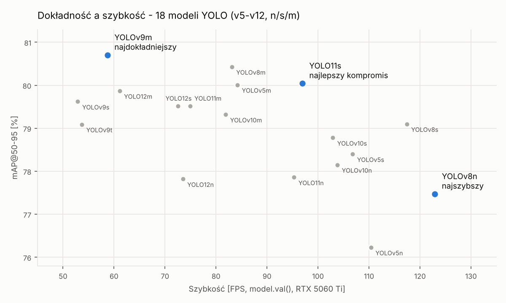
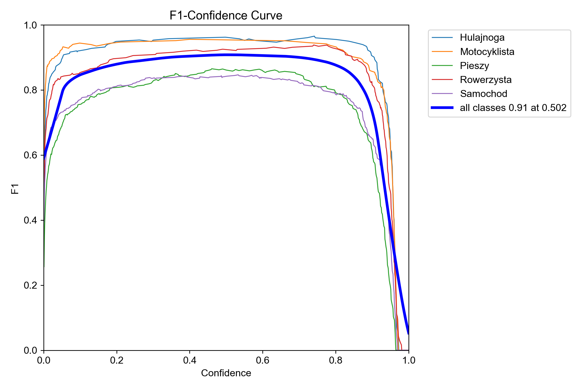
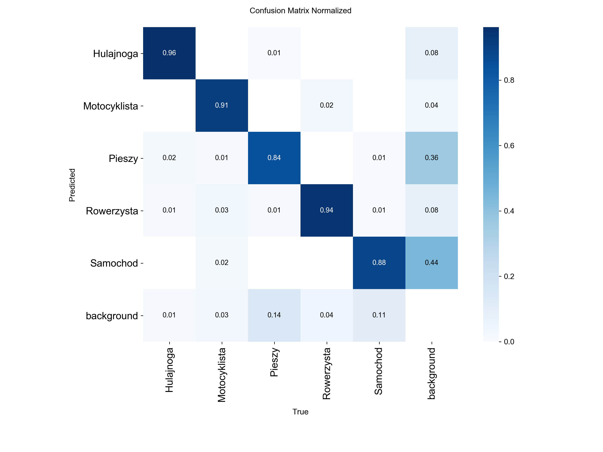

# Wykrywanie uczestników ruchu drogowego — porównanie 18 modeli YOLO

Kod i wyniki z pracy magisterskiej **„Badanie skuteczności głębokich sieci neuronowych w wykrywaniu uczestników ruchu drogowego”** (Politechnika Lubelska, Wydział Elektrotechniki i Informatyki, 2026).

> *EN: Comparison of 18 YOLO object detectors (v5, v8, v9, v10, v11, v12 × n/s/m) trained on a custom 5-class road-user dataset, with accuracy, speed and real-video evaluation.*



## Najważniejsze wyniki

- **YOLOv9m** — najwyższa dokładność: mAP@50-95 **80,70%**, mAP@50 93,01%, F1 0,91 przy progu pewności 0,50
- **YOLOv8n** — najszybszy: **122,9 FPS**, przy mAP@50-95 77,47%
- **YOLO11s** — najlepszy kompromis: mAP@50-95 80,04% przy 96,9 FPS
- Rozrzut dokładności między wszystkimi 18 modelami to tylko 4,5 p.p. (76,2–80,7%), a szybkości ponad dwukrotny (52,9–122,9 FPS). Wybór modelu to głównie decyzja o szybkości.
- Najtrudniejsza klasa: **Pieszy** (mAP@50-95 65,2% dla YOLOv9m). Najłatwiejsza: **Hulajnoga** (94,6%).
- Na wideo z rzeczywistego ruchu (Lublin, 1 401 klatek) pełny potok działa z prędkością **27,9 FPS** (YOLOv9m) i **33,2 FPS** (YOLOv8n). Szacunkowo **59–80% czasu obsługi klatki** przypada na operacje poza samym wnioskowaniem: dekodowanie, rysowanie i zapis. Dlatego wymiana modelu na szybszy daje w praktyce dużo mniej, niż sugerują benchmarki.

## Zakres

| Element | Opis |
|---|---|
| Modele | YOLOv5, v8, v9, v10, YOLO11, YOLO12 — warianty n/s/m (w v9: t/s/m) |
| Klasy (5) | Hulajnoga, Motocyklista, Pieszy, Rowerzysta, Samochód |
| Zbiór danych | 3 001 obrazów (w tym 502 obrazy tła), 3 749 obiektów, podział 60/20/20 |
| Trening | 100 epok, early stopping 20, 640×640, AutoBatch, AMP, seed 0 — identycznie dla każdego modelu |
| Sprzęt | NVIDIA RTX 5060 Ti 16 GB, Intel i5-12400F, 16 GB RAM, Windows 11 |
| Oprogramowanie | Python 3.12, PyTorch 2.11 + CUDA 12.8, Ultralytics 8.4.42 |

## Wyniki wszystkich modeli

mAP z logu treningu (najlepsza epoka, zbiór walidacyjny 600 obrazów). FPS = 1000 / (preprocess + inference + postprocess) z `model.val()`. F1 wyliczone z precyzji i czułości.

| Model | mAP@50 (%) | mAP@50-95 (%) | F1 | FPS |
|---|---:|---:|---:|---:|
| YOLOv5n | 90,58 | 76,23 | 0,881 | 110,4 |
| YOLOv5s | 91,40 | 78,40 | 0,895 | 106,8 |
| YOLOv5m | 91,90 | 80,01 | 0,910 | 84,2 |
| YOLOv8n | 91,28 | 77,47 | 0,894 | **122,9** |
| YOLOv8s | 91,02 | 79,10 | 0,899 | 117,4 |
| YOLOv8m | 92,41 | 80,43 | 0,905 | 83,1 |
| YOLOv9t | 92,10 | 79,09 | 0,902 | 53,7 |
| YOLOv9s | 91,55 | 79,62 | 0,904 | 52,9 |
| **YOLOv9m** | **93,01** | **80,70** | 0,909 | 58,7 |
| YOLOv10n | 91,39 | 78,15 | 0,895 | 103,8 |
| YOLOv10s | 91,37 | 78,78 | 0,895 | 102,9 |
| YOLOv10m | 91,59 | 79,32 | 0,888 | 81,9 |
| YOLO11n | 91,29 | 77,86 | 0,886 | 95,3 |
| YOLO11s | 92,23 | 80,04 | 0,908 | 96,9 |
| YOLO11m | 91,99 | 79,52 | 0,901 | 74,9 |
| YOLO12n | 91,14 | 77,82 | 0,893 | 73,5 |
| YOLO12s | 91,73 | 79,52 | 0,905 | 72,5 |
| YOLO12m | 92,64 | 79,87 | 0,901 | 61,1 |

Dane w CSV: [`results/models_summary.csv`](results/models_summary.csv). mAP@50-95 każdej klasy dla każdego modelu: [`results/per_class_map50-95.csv`](results/per_class_map50-95.csv). Pochodzą z osobnego przebiegu `model.val()`, więc mogą się różnić od tabeli o setne części punktu.

### Najlepszy model — YOLOv9m

| Krzywa F1 | Znormalizowana macierz pomyłek |
|---|---|
|  |  |

Przebieg treningu: [`results/yolov9m/results.png`](results/yolov9m/results.png). Krzywa PR: [`results/yolov9m/BoxPR_curve.png`](results/yolov9m/BoxPR_curve.png). Surowe dane: pliki CSV w [`results/yolov9m/`](results/yolov9m/).

## Zbiór danych

- Ok. 1/3 materiału **nagrana samodzielnie** na ulicach Lublina (luty–kwiecień 2026). Reszta pochodzi z publicznych źródeł, m.in. Roboflow Universe.
- Anotacja w Roboflow: połowa ręcznie, potem model pomocniczy z ręczną korektą ramek.
- Augmentacja offline zbioru treningowego (Albumentations): deszcz, mgła, jasność i kontrast, czyli symulacja trudnych warunków pogodowych. Po augmentacji zbiór treningowy liczy 6 319 obrazów.
- **Obrazy nie są publikowane** w tym repozytorium. Część pochodzi ze źródeł o licencjach, które nie pozwalają na redystrybucję, a nagrania własne zawierają twarze i tablice rejestracyjne.

Żeby uruchomić skrypty na własnych danych, umieść zbiór w formacie YOLO w `datasets/road-users/{train,valid,test}/{images,labels}`. Ścieżki są ustawione w [`configs/data.yaml`](configs/data.yaml).

## Struktura repozytorium

```
configs/
  data.yaml                   # klasy i ścieżki zbioru
  train_args_yolov9m.yaml     # pełne hiperparametry treningu (wspólne dla wszystkich modeli)
scripts/
  train.py                    # trening 18 modeli jeden po drugim
  collect_results.py          # zbiorcza tabela metryk, czasów i rozmiarów modeli
  export_val_curves.py        # szczegółowa ewaluacja jednego modelu → CSV
  predict.py                  # detekcja na zdjęciach i wideo + pomiar rzeczywistego FPS
  plot_accuracy_vs_speed.py   # wykres z początku tego README
results/                      # wyniki i wykresy
```

## Uruchomienie

```bash
python -m venv .venv
.venv\Scripts\activate          # Windows (Linux/macOS: source .venv/bin/activate)
pip install -r requirements.txt

python scripts/train.py                          # trening wszystkich modeli
python scripts/train.py --models yolo11s.pt      # albo wybranych
python scripts/collect_results.py                # tabela wyników
python scripts/predict.py --model yolov9m        # detekcja na materiałach z materialy/
```

Opcjonalne powiadomienia na Discorda podczas treningu: ustaw zmienną środowiskową `DISCORD_WEBHOOK_URL`.

## Metodyka pomiaru szybkości

- **FPS modelu** (tabela wyżej): `model.val()` na 600 obrazach walidacyjnych. Liczy tylko przetwarzanie obrazu przez sieć: preprocess, inferencję i postprocess (NMS).
- **FPS rzeczywisty** (`predict.py`): liczba klatek podzielona przez czas przetworzenia całego filmu. Obejmuje dekodowanie wideo, detekcję, rysowanie ramek i zapis. Ustawienia: `conf=0.50`, `iou=0.50`, agnostic NMS. Oba porównywane modele działały na identycznym materiale.
- **Udział narzutu poza wnioskowaniem** (59–80%) to **szacunek**, a nie pomiar profilerem: (czas pełnego cyklu − czas inferencji z `val()`) / czas pełnego cyklu.

## Licencja

Kod udostępniony na licencji [AGPL-3.0](LICENSE), tej samej co biblioteka Ultralytics, na której opiera się projekt.

## Autor

Karol Stefański — mgr inż. informatyki przemysłowej, Politechnika Lubelska
